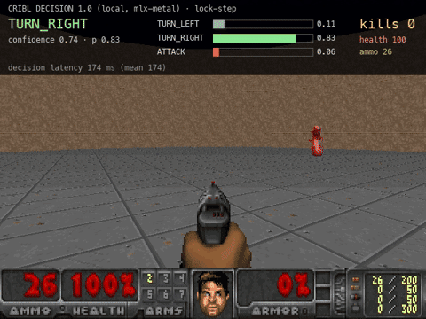
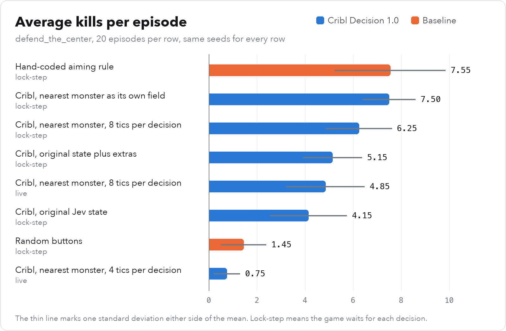

# Cribl Decision 1.0 Plays Doom

I ran [Cribl's open decision model](https://huggingface.co/cribl-ai/cribl-decision-1.0) locally on a Mac mini and let it play Doom. It never sees the screen. It reads the game state as JSON and picks one of three buttons.



<sub>Watch one minute of play in [`docs/cribl-doom.mp4`](docs/cribl-doom.mp4), where the game waits for each decision, or thirty seconds of live play at full game speed in [`docs/cribl-doom-live.mp4`](docs/cribl-doom-live.mp4). The bars show the probability the model gave each button, read from its output.</sub>

Model: `cribl-ai/cribl-decision-1.0` on `Qwen/Qwen3.5-4B-Base`. Hardware: Mac mini, Apple M4 Pro, 24 GB. Zero-shot, no fine-tuning.

## Short answer

Yes, it can play. With the game state laid out around the nearest monster, the model averaged 7.50 kills per episode over 20 episodes. A hand-coded aiming rule averaged 7.55 on the same 20 episodes, and random button presses averaged 1.45.

Each decision takes about 175 ms on the Mac mini. That is fast enough to play live at one decision every 8 game tics, which is 4.4 decisions per second. Live play costs some score, because the model acts on a state that is about 7 tics old.



## What I found

- **The layout of the state decides the score.** The original Jev demo sends a list of up to six monsters. With that list, Cribl scored 4.15 kills and fired at monsters that were far off centre. When I gave the nearest monster its own field, it scored 7.50. Both states hold the same facts. The hand-coded rule scores 7.55 on either one.
- **It needs about 175 ms per decision.** At one decision every 4 tics the budget is 114 ms, and live play fell to 0.75 kills. At one decision every 8 tics it scored 4.85 kills live and 6.25 in lock-step.
- **Wording and order change its answers a lot.** Only the wording that spells out the 8 degree firing rule plays well. The wording that describes what each button does never fired, and the minimal wording always fired. Reordering the same three buttons changed between 9 and 25 percent of decisions on fixed game states.
- **Its confidence is not a good guide to correctness here.** Its most confident picks agreed with the firing rule less often than its middling ones. Handing decisions below 0.4 confidence to the hand-coded rule still raised kills from 4.15 to 4.90.

## Results

The scenario is ViZDoom's `defend_the_center`. The player stands in the middle of a round room with a pistol and 26 bullets and cannot move. Every row is 20 episodes on seeds 1234 to 1253, the same for every row. Lock-step means the game waits for each decision. Live means the game runs at 35 tics per second while the model thinks.

| Configuration | Mode | Kills (mean, sd) | Hit rate | Survival | Decisions | Latency p50, p95 | Fallbacks |
|---|---|---|---|---|---|---|---|
| Random buttons | lock-step | 1.45, 0.94 | 9% | 9.8 s | 1721 | <1 ms | 0 |
| Hand-coded aiming rule | lock-step | 7.55, 2.31 | 56% | 14.4 s | 2537 | <1 ms | 0 |
| Cribl, original Jev state | lock-step | 4.15, 1.60 | 17% | 13.1 s | 2306 | 177, 205 ms | 0 |
| Cribl, original state plus armour and recent actions | lock-step | 5.15, 1.23 | 22% | 13.6 s | 2383 | 181, 253 ms | 0 |
| **Cribl, nearest monster as its own field** | lock-step | **7.50, 1.10** | 32% | 14.9 s | 2618 | 174, 197 ms | 0 |
| Cribl, nearest monster, 8 tics per decision | lock-step | 6.25, 1.37 | 30% | 14.0 s | 1233 | 174, 182 ms | 0 |
| Hand-coded aiming rule | live | 7.75, 1.89 | 66% | 14.1 s | 4940 | <1 ms | 0 |
| Cribl, nearest monster, 4 tics per decision | live | 0.75, 0.55 | 88% | 8.8 s | 786 | 174, 190 ms | 0 |
| Cribl, nearest monster, 8 tics per decision | live | 4.85, 1.63 | 27% | 13.7 s | 1243 | 174, 175 ms | 0 |

Kills come from the engine's kill counter. Hit rate is hits divided by shots fired. Survival is the time until death, and an episode ends at 60 seconds. A fallback is a decision the model did not make, and every row has zero fallbacks. The tables for every experiment, including prompt wording, candidate order, decision interval and confidence, are in [results/REPORT.md](results/REPORT.md).

## How it works

ViZDoom reports the player's health, ammunition, position and the position of every monster. The agent turns the monster positions into a distance and a bearing, where 0 degrees is straight ahead. The state goes to the model as JSON, e.g.:

```json
{"health": 100, "ammo": 21, "armor": 0,
 "nearest_monster": {"distance": 412, "bearing_deg": 7},
 "monsters_in_view": 1, "monsters_total": 4, "previous_action": "TURN_LEFT",
 "note": "bearing 0 = dead ahead. POSITIVE bearing means the monster is to your LEFT (turn left to face it); NEGATIVE means to your RIGHT."}
```

The prompt lists the three buttons as lettered candidates A, B and C, then the state, and ends with "Answer:". The model runs one forward pass. The agent reads the scores for the letter tokens at the last position, turns them into probabilities, and presses the button with the highest one. The model generates no text. The [technical notes](docs/TECHNICAL.md) give the full prompt and the tests behind each claim.

## Notes for the Cribl team

- The model card mentions an accompanying candidate scoring implementation, but I could not find it on Hugging Face or GitHub. I built a compatible readout instead. To choose the prompt layout, I tested seven layouts on 27 questions with known answers. In the plain layout ending in "Answer:", the adapter puts 95 to 99 percent of the next token probability on the candidate letters. The base model alone puts 25 to 57 percent there. In the chat template the adapter puts only 39 to 54 percent there. The exact training format is still a guess, and the official readout could score higher.
- The loading snippet on the model card uses `AutoModelForCausalLM`. With transformers 5.19, that class names its modules differently from the adapter, so PEFT prints a warning and runs the base model without the adapter. Loading `Qwen3_5ForConditionalGeneration` fixes it. My code checks that all 304 adapter tensors are applied.
- On a Mac, MLX runs the model about 2.3 times faster than PyTorch on MPS. Caching the fixed part of the prompt more than halves the time again. The two paths agree to within 0.02 in probability.

## Limits

- The test uses one small scenario with three buttons and no movement.
- Twenty episodes per row is a small sample. Differences smaller than about one kill are within the noise.
- I chose the state layouts and wordings while looking at these benchmark results, so the best row is a favourable setup.
- TypeSafe's Jev was not run, because I had no API key. The code supports it with `--brain jev`.

## Try it

You need Python 3.11 to 3.13. The first run downloads the base model (9.3 GB) and the adapter (58 MB) from Hugging Face.

```bash
uv venv -p 3.12 .venv
uv pip install -p .venv/bin/python -e ".[cribl,mlx,record,test]"   # leave out mlx if you are not on Apple Silicon
.venv/bin/python selfcheck.py

.venv/bin/python doom_agent.py --brain cribl --state compact --episodes 20 --seed 1234
.venv/bin/python doom_agent.py --brain heuristic --episodes 20 --seed 1234
.venv/bin/python doom_agent.py --brain cribl --state compact --live --tics 8      # real time
.venv/bin/python record.py --brain cribl --state compact --seconds 60 --out docs/cribl-doom.mp4
```

The [technical notes](docs/TECHNICAL.md) list every command, flag and backend, and explain how to rerun the full benchmark.

## More detail

- [docs/TECHNICAL.md](docs/TECHNICAL.md) covers the readout, what the tests verify, install options, commands, flags and file layout.
- [results/REPORT.md](results/REPORT.md) has every experiment, generated by `report.py` from the benchmark files.
- [results/traces/](results/traces/) holds a CSV row for every decision, with the state, the probabilities and the latency.
- [docs/](docs/) has the recordings, plus a still image and a short clip for sharing, made by `tools/make_media.py`.

## Credits and license

This project extends [tirukovelamanoj/jev-plays-doom](https://github.com/tirukovelamanoj/jev-plays-doom), which ran the same test with TypeSafe's hosted Jev model. Its ViZDoom setup, scenario and Jev brain are kept, and its original README and footage are in [docs/jev/](docs/jev/).

MIT, as the original project. See [LICENSE](LICENSE). The Cribl adapter is Apache-2.0 and the Qwen base model has its own license. Neither is included here.
