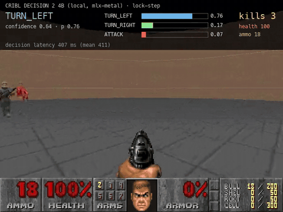
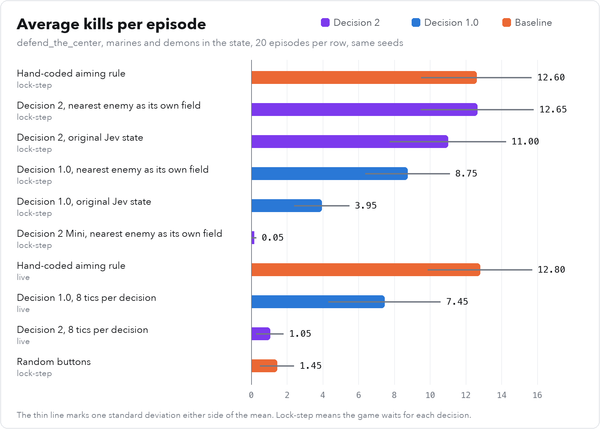

# Cribl Decision plays Doom

I ran Cribl's open decision models locally on a Mac mini and let them play Doom. The models never see the screen. Each one reads the game state as JSON and picks one of three buttons. This round adds [Cribl Decision 2](https://huggingface.co/cribl-ai/cribl-decision-2-4B) next to [Decision 1.0](https://huggingface.co/cribl-ai/cribl-decision-1.0), and the recordings now use the original Doom II art.



<sub>Watch one minute of Decision 2 in [`docs/cribl2-doom.mp4`](docs/cribl2-doom.mp4). The game waits for each decision. The bars show the probability the model gave each button, read from its output.</sub>

Models: `cribl-ai/cribl-decision-2-4B` and `cribl-ai/cribl-decision-2-0.8B` (Mini), and `cribl-ai/cribl-decision-1.0` on `Qwen/Qwen3.5-4B-Base`. Hardware: Mac mini, Apple M4 Pro, 24 GB. Zero-shot, no fine-tuning.

## Short answer

Decision 2 (4B) plays as well as a hand-coded aiming rule. With the nearest enemy given its own field in the state, it averaged 12.65 kills per episode over 20 episodes. The hand-coded rule averaged 12.60 on the same 20 episodes. Decision 1.0 averaged 8.75 on the same setup, and random button presses averaged 1.45.

Decision 2 is slower. Each decision takes about 395 ms on the Mac mini, against about 175 ms for 1.0. Decision 2 is too slow to play live, and it scored 1.05 kills when the game did not wait for it. The Mini model (0.8B) is fast at about 70 ms, but it almost never fires, so it can't play.



## What I found

- **Decision 2 follows the firing rule almost exactly.** When the nearest enemy was within 8 degrees of straight ahead, it fired 100% of the time. When the enemy was further off, it fired 1% of the time. When the enemy was more than 30 degrees off, it turned the correct way 99% of the time. Decision 1.0 fired 98% of the time near the centre, but it also fired on 30% of the decisions where the enemy was off centre, so it wasted bullets.
- **Decision 2 cares much less about the layout of the state.** With the original Jev state, a list of every enemy, Decision 2 scored 11.00 kills and Decision 1.0 scored 3.95. Both states hold the same facts. Decision 1.0 needed the nearest enemy laid out for it, and Decision 2 mostly did not.
- **Decision 2 is too slow for live play.** In live play the game runs at 35 tics per second while the model thinks. Decision 2 acted on a state that was on average 14.4 tics old, so it turned past its targets and the marines reached it. Decision 1.0 acted on a state about 7 tics old and scored 7.45 kills live.
- **The Mini model does not fire.** With the compact state it fired on 0 of the 461 decisions where an enemy was dead ahead, and it scored 0.05 kills. With the original Jev state it scored 1.80, close to random.
- **Wording still decides the score.** On the original benchmark, Decision 2 played well only with the wording that spells out the 8 degree firing rule. With wording that describes what each button does, it scored 0.95 kills. The full tables are in [results/REPORT.md](results/REPORT.md).

## A flaw in the first benchmark

The first version of this benchmark hid three of the five enemies from every brain. ViZDoom's `defend_the_center` spawns three chainsaw marines and two demons. Both kinds attack the player and both count as kills. The state code came from the Jev project, and it left the marines out of the state, so no brain could aim at them. I found the flaw while checking why Decision 2 fired into rooms the state described as empty. The marines were in those rooms.

I fixed the state and reran the key rows on the same seeds. The hand-coded rule went from 7.55 to 12.60 kills, and its survival time roughly doubled. With the marines in the state, no brain sees an empty room any more. The new default is `--targets all`. The old numbers are kept in [results/REPORT.md](results/REPORT.md) as the original benchmark, and you can reproduce them exactly with `--targets demons`.

The first write-up said Decision 1.0 scored 7.50 kills against 7.55 for the hand-coded rule. With the marines in the state, the scores are 8.75 against 12.60. The original comparison flattered Decision 1.0, because the rule lost more from the missing marines than the model did.

## Results

The scenario is ViZDoom's `defend_the_center`. The player stands in the middle of a round room with a pistol and 26 bullets and cannot move. Every row is 20 episodes on seeds 1234 to 1253, the same for every row, with the marines in the state. Lock-step means the game waits for each decision. Live means the game runs at 35 tics per second while the model thinks. "Compact state" means the nearest enemy has its own field.

| Configuration | Mode | Kills (mean, sd) | Hit rate | Survival | Decisions | Latency p50, p95 |
|---|---|---|---|---|---|---|
| Random buttons | lock-step | 1.45, 0.94 | 9% | 9.8 s | 1721 | <1 ms |
| Hand-coded aiming rule | lock-step | 12.60, 3.08 | 49% | 27.2 s | 4762 | <1 ms |
| Decision 1.0, original Jev state | lock-step | 3.95, 1.54 | 16% | 13.1 s | 2306 | 263, 341 ms |
| Decision 1.0, compact state | lock-step | 8.75, 2.36 | 35% | 21.7 s | 3807 | 173, 183 ms |
| Decision 2 (4B), original Jev state | lock-step | 11.00, 3.24 | 47% | 24.0 s | 4198 | 470, 554 ms |
| **Decision 2 (4B), compact state** | lock-step | **12.65, 3.15** | 49% | 26.9 s | 4713 | 394, 451 ms |
| Decision 2 Mini, original Jev state | lock-step | 1.80, 2.02 | 54% | 10.4 s | 1835 | 90, 91 ms |
| Decision 2 Mini, compact state | lock-step | 0.05, 0.22 | 100% | 8.0 s | 1404 | 69, 73 ms |
| Hand-coded aiming rule | live | 12.80, 2.91 | 50% | 26.4 s | 9233 | <1 ms |
| Decision 1.0, compact state, 8 tics per decision | live | 7.45, 3.14 | 36% | 20.0 s | 1807 | 172, 175 ms |
| Decision 2 (4B), compact state, 8 tics per decision | live | 1.05, 0.76 | 91% | 9.3 s | 412 | 394, 452 ms |

Kills come from the engine's kill counter. Hit rate is hits divided by shots fired. Survival is the time until death, and an episode ends at 60 seconds. No model ever failed to give an answer, so no row used a fallback. The tables for every experiment are in [results/REPORT.md](results/REPORT.md). The report covers prompt wording, candidate order, decision interval, confidence, and the original benchmark without the marines.

## How it works

ViZDoom reports the player's health, ammunition, position and the position of every enemy. The agent turns the enemy positions into a distance and a bearing, where 0 degrees is straight ahead. The state goes to the model as JSON, e.g.:

```json
{"health": 100, "ammo": 21, "armor": 0,
 "nearest_monster": {"distance": 412, "bearing_deg": 7},
 "monsters_in_view": 1, "monsters_total": 5, "previous_action": "TURN_LEFT",
 "note": "bearing 0 = dead ahead. POSITIVE bearing means the monster is to your LEFT (turn left to face it); NEGATIVE means to your RIGHT."}
```

The two model versions read their answer in different ways.

- **Decision 1.0** is a LoRA adapter on a Qwen3.5 base model. The prompt lists the three buttons as lettered candidates A, B and C, then the state, and ends with "Answer:". The agent reads the scores for the letter tokens after one forward pass. Cribl did not publish a reader for 1.0, so I built and tested this one myself.
- **Decision 2** ships with Cribl's own reader, `decision.py`, and a small scoring head. The model reads the whole prompt in both directions and gives each candidate a score, and the scores become probabilities. The agent builds the prompt with `decision.py` itself, so the prompt format is Cribl's and not my guess.

Neither model generates text. The [technical notes](docs/TECHNICAL.md) give the full prompts and the tests behind each claim.

## Running Decision 2 on a Mac

Cribl's `decision.py` runs on PyTorch. On Apple Silicon, PyTorch has no fast kernel for the model's linear attention layers, so the 4B model took about 1.2 s per decision. I ported the model to MLX, which has Metal kernels for those layers. The port makes the same three changes to the stock Qwen3.5 model that `decision.py` makes:

- The full attention layers read the prompt in both directions.
- Eight of the linear attention layers also read the prompt right to left.
- Cribl's scoring head replaces the language model head.

The port is about 2.7 times faster for the 4B model and about 5 times faster for Mini. A test compares it with Cribl's reference code on ten Doom states. The largest difference in any probability was 0.006 for the 4B model and 0.02 for Mini. The test also checks that the port picks the same button as the reference whenever the reference's top two buttons are more than 0.05 apart. The agent uses MLX when it is installed and falls back to Cribl's code otherwise (`--backend torch`).

## Notes for the Cribl team

- The Decision 2 model card gives `cribl-ai/cribl-decision-2` as the default repository, but the weights are in the separate `-4B` and `-0.8B` repositories. I pinned both by revision.
- Shipping `decision.py` with the weights made Decision 2 much easier to test than 1.0. For 1.0 I had to guess the prompt layout, and the exact training format is still unknown.
- Decision 2 is slower than 1.0 on the same machine, about 395 ms against 175 ms per decision. The extra reverse pass costs time. Moreover, a model that reads in both directions can't reuse a cached copy of the fixed part of the prompt, which made the 1.0 code about twice as fast.

## Limits

- The test uses one small scenario with three buttons and no movement.
- Twenty episodes per row is a small sample. Differences smaller than about one kill are within the noise, so Decision 2 and the hand-coded rule are level.
- I chose the state layouts and wordings while looking at the Decision 1.0 results, so the best rows are a favourable setup. I kept them unchanged for Decision 2.
- A few decisions took much longer than usual, e.g., one decision on the original benchmark took 38 s. The Mac was doing other work at those moments. Lock-step scores do not depend on time, and the medians are stable.
- TypeSafe's Jev was not run, because I had no API key. The code supports it with `--brain jev`.

## Try it

You need Python 3.11 to 3.13. The first Decision 2 run downloads the 4B model (7.9 GB) or Mini (1.4 GB) from Hugging Face. Decision 1.0 downloads its base model (9.3 GB) and the adapter (58 MB).

```bash
uv venv -p 3.12 .venv
uv pip install -p .venv/bin/python -e ".[cribl,mlx,record,test]"   # leave out mlx if you are not on Apple Silicon
.venv/bin/python selfcheck.py

.venv/bin/python doom_agent.py --brain cribl2 --size 4b --state compact --episodes 20 --seed 1234
.venv/bin/python doom_agent.py --brain cribl --state compact --episodes 20 --seed 1234
.venv/bin/python doom_agent.py --brain heuristic --episodes 20 --seed 1234
.venv/bin/python record.py --brain cribl2 --state compact --seconds 60 --out docs/cribl2-doom.mp4
```

The game uses the free Freedoom art by default. To see the original Doom art, point `--iwad` (or the `DOOM_IWAD` environment variable) at your own copy of `DOOM2.WAD`, e.g., from the Steam release of DOOM + DOOM II. The art does not change the game, and I checked that every episode gives the same result with either art. WAD files are not included here and are ignored by git.

The [technical notes](docs/TECHNICAL.md) list every command, flag and backend, and explain how to rerun the full benchmark.

## More detail

- [docs/TECHNICAL.md](docs/TECHNICAL.md) covers both readers, the MLX port, what the tests verify, install options, commands, flags and file layout.
- [results/REPORT.md](results/REPORT.md) has every experiment, generated by `report.py` from the benchmark files.
- [results/traces/](results/traces/) holds a CSV row for every decision, with the state, the probabilities and the latency.
- [docs/](docs/) has the recordings, plus a still image and a short clip for sharing, made by `tools/make_media.py`. The Decision 1.0 recordings from the first write-up are [`docs/cribl-doom.mp4`](docs/cribl-doom.mp4) and [`docs/cribl-doom-live.mp4`](docs/cribl-doom-live.mp4). They use Freedoom art and the original state without the marines.

## Credits and license

This project extends [tirukovelamanoj/jev-plays-doom](https://github.com/tirukovelamanoj/jev-plays-doom), which ran the same test with TypeSafe's hosted Jev model. Its ViZDoom setup, scenario and Jev brain are kept, and its original README and footage are in [docs/jev/](docs/jev/).

MIT, as the original project. See [LICENSE](LICENSE). Cribl Decision 2 and the Decision 1.0 adapter are Apache-2.0, and the Qwen base model has its own license. None of the models are included here. Doom and Doom II are owned by id Software, and no game data is included.
